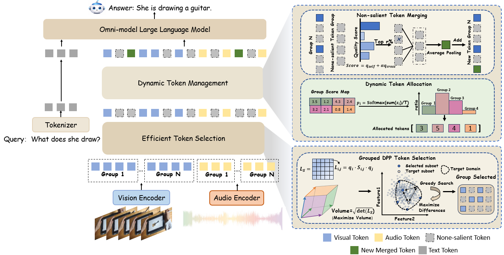
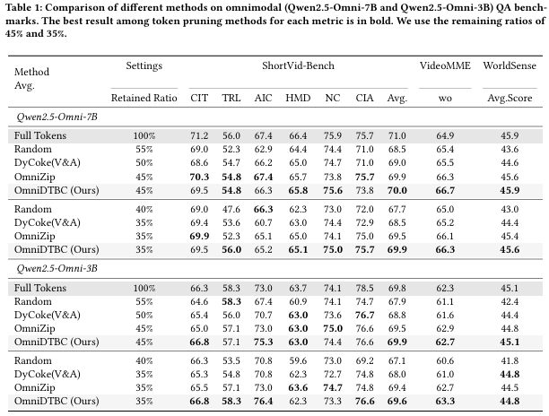

# OmniDTBC

**Dynamic Token Budget Compression for Video-Audio Large Language Models**

OmniDTBC is a training-free framework for compressing audio and visual tokens in omni-modal large language models. Built on Qwen2.5-Omni, it combines token importance scoring, diversity-aware selection with determinantal point processes (DPPs), and dynamic token budget allocation across temporal windows.



## Repository Structure

```text
.
├── demo.py                         # Video-audio inference demo
├── setup.sh                        # Core Python dependency installation
├── utils/
│   ├── omnidtbc.py                  # Token compression implementation
│   └── modeling_qwen2_5_omni.py     # Qwen2.5-Omni integration
├── qwen-omni-utils/                # Bundled multimodal preprocessing utilities
├── lmms-eval/                      # Evaluation framework and model adapter
├── figures/                        # Method overview and benchmark results
└── LICENSE
```

## Installation

Run the commands below from the repository root. The demo uses an NVIDIA GPU on `cuda:0` with FlashAttention-2. Use a Linux environment with a compatible CUDA toolkit and GPU; see the [FlashAttention installation requirements](https://github.com/Dao-AILab/flash-attention#installation-and-features).

### 1. Create an environment

```bash
conda create -n omnidtbc python=3.10 -y
conda activate omnidtbc
python -m pip install --upgrade pip
conda install -c conda-forge ffmpeg -y
```

### 2. Install PyTorch

Install CUDA-enabled builds of `torch`, `torchvision`, and `torchaudio` that match your Python and CUDA versions. Follow the [PyTorch installation guide](https://pytorch.org/get-started/locally/) or select a compatible release from [previous versions](https://pytorch.org/get-started/previous-versions/).

### 3. Install project dependencies

```bash
bash setup.sh
python -m pip install packaging psutil ninja
python -m pip install flash-attn --no-build-isolation
```

The setup script installs `transformers==4.52.3`, `accelerate`, `moviepy`, and the bundled `qwen-omni-utils` package. Keep the Transformers version aligned with the custom model implementation.

## Quick Start

Provide a Qwen2.5-Omni model directory or Hugging Face model ID and a local video file. The demo reads both the video frames and its audio track, then streams a text response to the terminal. **The input video must contain an audio track.**

The examples use `Qwen/Qwen2.5-Omni-7B`. Replace `/path/to/video.mp4` with your own video path. To load downloaded weights, replace the model ID with your local model directory.

### Standard inference

```bash
python demo.py \
  --model_path Qwen/Qwen2.5-Omni-7B \
  --video /path/to/video.mp4 \
  --describe "Describe this video."
```

### Inference with OmniDTBC

```bash
python demo.py \
  --model_path Qwen/Qwen2.5-Omni-7B \
  --video /path/to/video.mp4 \
  --describe "Describe what happens in the video and what can be heard." \
  --omnidtbc \
  --remaining_audio 0.6 \
  --remaining_video 0.3 \
  --video_chunk_frames 8 \
  --alpha 0.02
```

### Command-line arguments

| Argument | Default | Description |
| --- | --- | --- |
| `--model_path` | Required | Local model directory or Hugging Face model ID. |
| `--video` | Required | Path to a video file with an audio track. |
| `--describe` | `Describe this video.` | Instruction or question for the model. |
| `--omnidtbc` | Disabled | Enable OmniDTBC token compression. |
| `--remaining_audio` | `0.6` | Target fraction of audio tokens to retain. |
| `--remaining_video` | `0.3` | Target fraction of visual tokens to retain. |
| `--video_chunk_frames` | `8` | Number of frames in each local visual DPP window. |
| `--alpha` | `0.02` | Weight of cross-modal similarity in token importance scores. |

Compression arguments apply when `--omnidtbc` is enabled. Use retention ratios in `(0, 1]` and a positive integer for `--video_chunk_frames`. Actual retained counts depend on rounding and budget constraints within each window.

The demo currently sets `HF_ENDPOINT` to `https://hf-mirror.com`. Update that setting in [demo.py](demo.py) if you use a different Hugging Face endpoint.

## Evaluation

The bundled [lmms-eval](lmms-eval/) framework includes a modified `qwen2_5_omni` adapter and task configurations for Video-MME and WorldSense.

Install the evaluation dependencies in the same environment:

```bash
python -m pip install -e "./lmms-eval[audio]"
python -m pip install "transformers==4.52.3"
```

Prepare the benchmark videos and configure their cache locations before evaluation. See the [Video-MME task files](lmms-eval/lmms_eval/tasks/videomme/) and [WorldSense task files](lmms-eval/lmms_eval/tasks/worldsense/) for dataset settings and expected video paths. Both tasks resolve video locations relative to `HF_HOME`.

Run the following example from the repository root:

```bash
WRAPPER=OmniDTBC python -m lmms_eval \
  --model qwen2_5_omni \
  --model_args "pretrained=Qwen/Qwen2.5-Omni-7B,attn_implementation=flash_attention_2,remain_audio_ratio=0.6,remain_video_ratio=0.3,video_chunk_frames=8,alpha=0.02" \
  --tasks videomme \
  --batch_size 1 \
  --output_path ./outputs/videomme
```

Set `--tasks worldsense` to evaluate WorldSense. For standard model inference, omit `WRAPPER=OmniDTBC`.

The evaluation adapter uses `remain_audio_ratio` and `remain_video_ratio` in `--model_args`; the demo uses `--remaining_audio` and `--remaining_video`.

## Benchmark Results

The table below summarizes the reported results on ShortVid-Bench, Video-MME, and WorldSense for Qwen2.5-Omni-7B and Qwen2.5-Omni-3B at different token retention ratios.



## Acknowledgments

This project builds on [OmniZip](https://github.com/KD-TAO/OmniZip), [Qwen2.5-Omni](https://github.com/QwenLM/Qwen2.5-Omni), [lmms-eval](https://github.com/EvolvingLMMs-Lab/lmms-eval), and [FlashAttention](https://github.com/Dao-AILab/flash-attention). We thank their authors and contributors for making their work available.

## License

This project is distributed under the [Apache License 2.0](LICENSE). Bundled third-party components retain their respective licenses.
